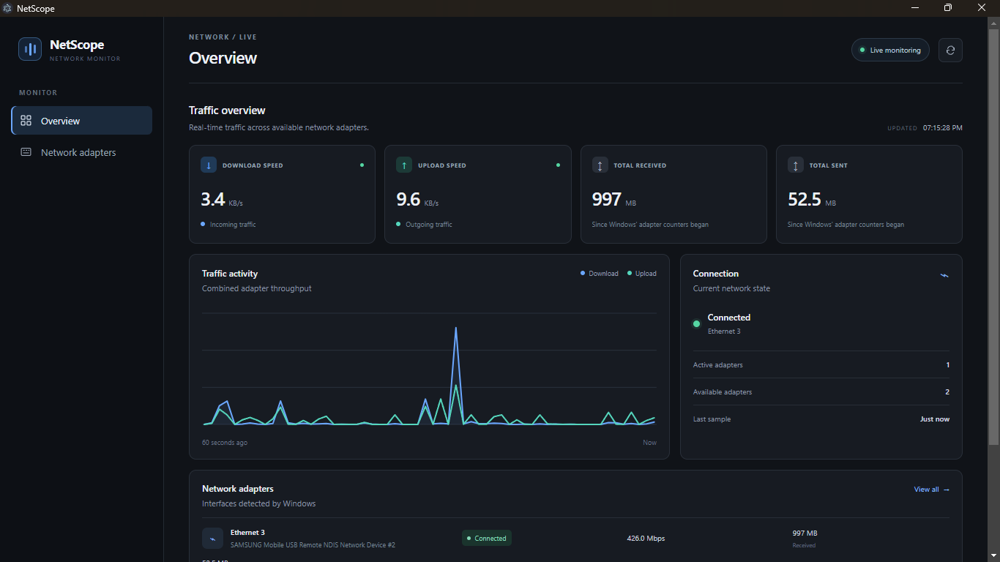

# NetScope

A lightweight Windows network monitor built with Electron.

NetScope provides a clean, straightforward interface for viewing network adapter information and monitoring network activity on Windows.

## Features

- **Live network monitoring** — periodically retrieves network adapter statistics.
- **Adapter information** — displays available details about network interfaces.
- **Lightweight desktop app** — built with Electron and JavaScript.
- **Simple interface** — a clean UI focused on useful information without unnecessary clutter.
- **Windows-focused** — uses native Windows networking tools to retrieve adapter statistics.

## Preview



## Tech Stack

- JavaScript
- Electron
- HTML and CSS
- Windows PowerShell networking cmdlets

## Requirements

- Windows 10 or Windows 11
- Node.js and npm (required to run from source)
- PowerShell with the `NetAdapter` module available

## Run Locally

Clone the repository:

```bash
git clone https://github.com/Itz-Veyn-Dev/NetScope.git
cd NetScope
```

Install dependencies:

```bash
npm install
```

Start the application:

```bash
npm start
```

## Download

Prebuilt Windows installers will be published in the project's [GitHub Releases](https://github.com/Itz-Veyn-Dev/NetScope/releases).

## How It Works

NetScope retrieves network adapter statistics through Windows PowerShell and displays the available information in its desktop interface.

Live statistics depend on the network adapters and networking capabilities available on the system.

## Platform Support

NetScope currently targets Windows. Other operating systems are not officially supported.

## License

A license has not yet been specified. Until one is added to this repository, all rights remain with the copyright holder.
